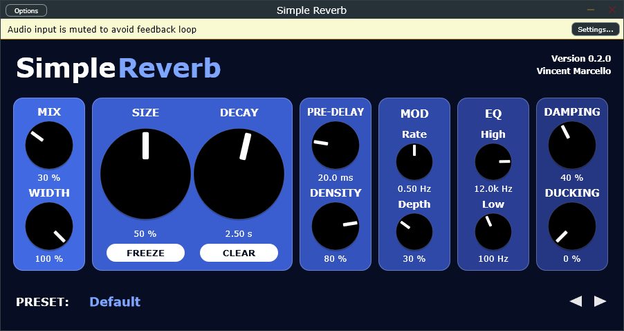

# Simple Reverb

A starter algorithmic reverb plugin (VST3 + standalone) built with JUCE and CMake.



Controls: Mix, Width, Size, Decay, Pre-Delay, Density, Mod Rate/Depth, High/Low Cut, Damping,
Ducking, Freeze, Clear, plus 8 factory presets.

The engine (`Source/ReverbEngine.h`, no JUCE dependency) is a 4-stage Hadamard diffuser feeding an
8-line Householder feedback delay network with per-line RT60 gains, in-loop damping and slow
delay modulation. `cmake -B build -DSIMPLEREVERB_TESTS=ON` builds `EngineTest`, which checks
the measured decay time, stability and freeze.

## Requirements (Windows)

- Visual Studio 2022 or Build Tools 2022 with the "Desktop development with C++" workload
- CMake 3.22+
- Git (CMake downloads JUCE from GitHub on first configure)

## Build

```
cmake -B build -G "Visual Studio 17 2022" -A x64
cmake --build build --config Release
```

Output: `build/SimpleReverb_artefacts/Release/VST3/Simple Reverb.vst3`

## Install

Copy `Simple Reverb.vst3` into `C:\Program Files\Common Files\VST3` (needs admin), then rescan
plugins in your DAW.
